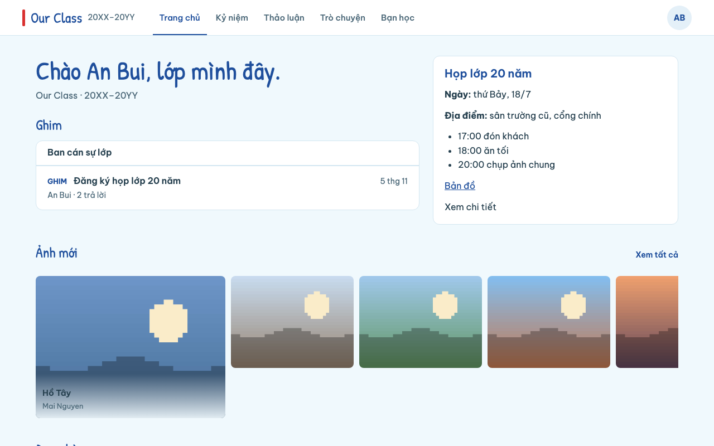
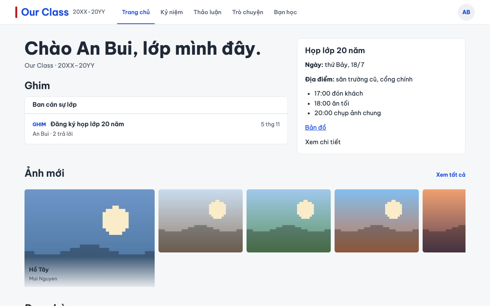
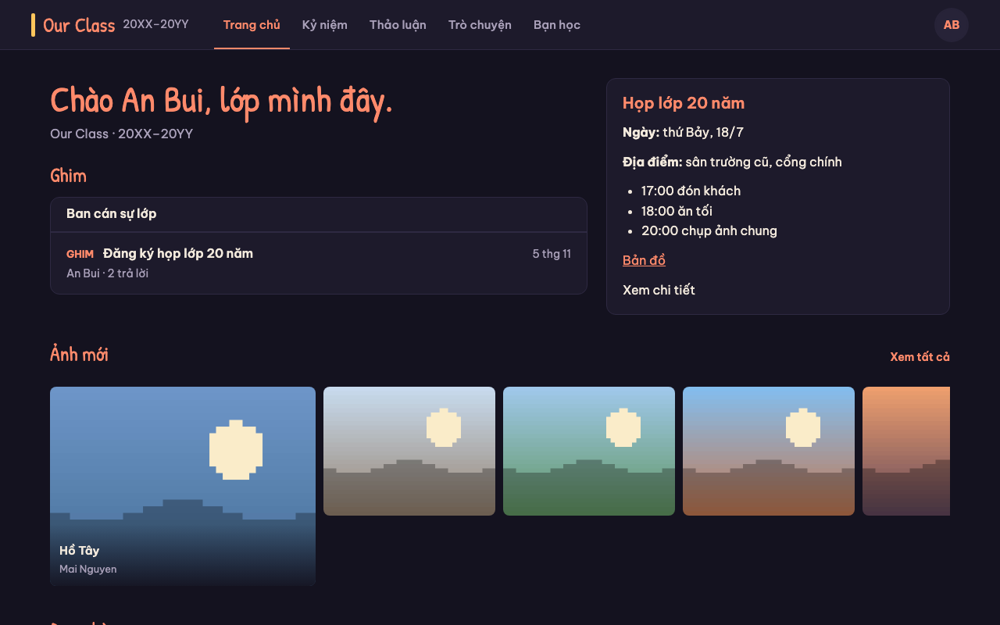

# Class Hub

A small, private, mobile-first reunion website for one school class: a photo wall, a discussion board, a live chat
room, a private member directory and a simple admin page. Classmates sign in with Google (or an emailed one-time
PIN), only invited addresses get in, and the app runs on Cloudflare's free tier.

## Before you start: what it can cost

Class Hub has no subscription, but it is not guaranteed to be free. Read this before you deploy.

- **R2 needs billing activated.** Cloudflare R2 requires a payment method in the account, even when usage stays inside
  the free allowance.
- **The app's storage cap is not a billing cap.** Class Hub stops uploads at 9 GB (and warns at 8 GB), but another app
  in the same Cloudflare account, ordinary operations, or provider overage can still produce a bill.
- **Use a dedicated Cloudflare account for Class Hub**, and **turn on billing notifications** (Manage Account →
  Billing → Notifications), so its usage never mixes with another project.
- **Possible costs:** a custom domain (optional), storage for off-site backups, and overage on any Cloudflare product.

## What it does

- **Home:** pinned notices and the reunion details.
- **Memories:** photos optimized in the browser, organized by album and year, served only to members.
- **Discussions:** threads with one level of comments, pinning and locking.
- **Live chat:** one room, real-time, history kept in the database.
- **Classmates:** a private directory where each member decides who sees each contact field.
- **Admin:** invitations, suspension, info pages, site name, theme, feature toggles, storage usage and backup status.
- **Notifications:** opt-in Web Push per device, with per-member kinds and a temporary mute.
- **Your data stays yours:** a full backup (SQL + NDJSON + every photo, with checksums) that restores without
  Cloudflare.

## Screenshots

The same Home screen in the three shipped themes. Yearbook is the default; Minimal has light and dark; Night is dark
only.

| Yearbook (light) | Minimal (light) | Night (dark) |
|---|---|---|
|  |  |  |

## Requirements

- Node.js 24 or newer, npm and Git.
- A **dedicated** Cloudflare account on Workers Free with a Zero Trust Free organization (up to 50 members, admins
  included).
- **R2 activated** in that account (it asks for a payment method; see "what it can cost" above).
- `age` 1.x, for encrypted backups.
- A Google account to create the OAuth client used by Cloudflare Access (no Google Workspace needed).
- Optionally, a domain. Without one the site lives on its free `workers.dev` hostname.

## Quick start

```bash
git clone https://github.com/rey5137/classhub.git && cd classhub
npm ci
cp .env.cloudflare.example .env.cloudflare   # fill CLOUDFLARE_ACCOUNT_ID and CLOUDFLARE_API_TOKEN
npm run setup        # creates D1, a private R2 bucket, the Worker config, secrets and the bootstrap admin invite
npm run deploy       # deploys locked: no private page is reachable yet
# follow docs/GOOGLE_ACCESS.md, then:
npm run preflight    # checks account, bindings, Access, hostnames, bucket privacy and migrations
npm run unlock       # opens the site to approved members
npm run invite -- add <email> --role admin   # add the next admin, then the rest of the class
```

No source file needs editing: everything account-specific lives in the gitignored `.env.cloudflare` and
`wrangler.jsonc`. The full walkthrough is in [docs/DEPLOY_CLOUDFLARE.md](docs/DEPLOY_CLOUDFLARE.md).

## The backup promise

Backups are the admin's job, and the app makes them hard to get wrong. `npm run backup` writes one `age`-encrypted
archive with the database, a portable NDJSON copy of every table, and every photo, plus checksums and a manifest.
`npm run verify-backup` checks an archive, and `npm run restore` restores it into a new database and bucket, or onto a
computer for offline use. Keep the private key away from the archives and copy them off Cloudflare. See
[docs/BACKUP_RESTORE.md](docs/BACKUP_RESTORE.md).

## Documentation

- [docs/DEPLOY_CLOUDFLARE.md](docs/DEPLOY_CLOUDFLARE.md): deploy, configure, unlock, update.
- [docs/GOOGLE_ACCESS.md](docs/GOOGLE_ACCESS.md): Cloudflare Access and Google sign-in.
- [docs/BACKUP_RESTORE.md](docs/BACKUP_RESTORE.md): back up, verify and restore.
- [docs/THEMES.md](docs/THEMES.md): the shipped themes and how to add one.
- [docs/PRIVACY.md](docs/PRIVACY.md): what the site stores and who can see it.
- [docs/spec/SPEC.md](docs/spec/SPEC.md): the specification and the rules the app keeps.
- [CONTRIBUTING.md](CONTRIBUTING.md), [SECURITY.md](SECURITY.md), [CODE_OF_CONDUCT.md](CODE_OF_CONDUCT.md) and
  [CHANGELOG.md](CHANGELOG.md).

## License

[MIT](LICENSE). The repository ships synthetic demo data only; real members' data, photos, account ids and secrets
never enter Git.
