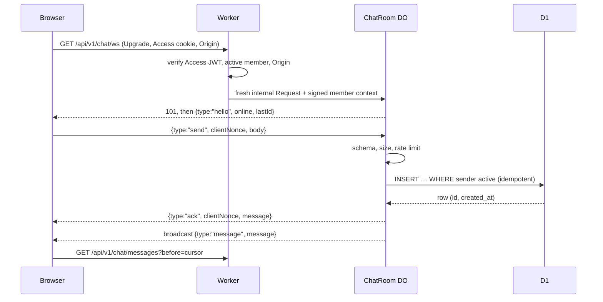

# 09 — Live chat

**Covers:** The chat room, the WebSocket handshake and trusted context, the ChatRoom Durable Object, message persistence, history, presence, suspension, retention, archive and pruning.
**Read when:** touching `/chat`, `src/workers/chat-room.ts`, the `RealtimeHub` port, chat history or the chat archive scripts.
**Owns:** `R-CHAT-*`, `AC-CHAT-*`.
**Index:** `docs/spec/SPEC.md` (product boundary §1, locked decisions D1–D10, routing). Section numbers are global: `§9.n` is in this file.

---

## 9.1 Room and messages

- **R-CHAT-01** One room per deployment (`room_id = "main"`). Messages are text: Unicode and emoji, 1–1,000
  characters after trimming, no attachments, no Markdown (links are auto-linked on display, `https:` only).
- **R-CHAT-02** The server generates the message id (UUIDv7) and `created_at`; the client sends a `clientNonce`
  (UUID) per message, reused on retry. `(sender_id, client_nonce)` is unique, so a retried send returns the original
  message instead of a duplicate.
- **R-CHAT-03** Senders may delete their own message and admins any message; a deleted message is a tombstone
  (`deleted_at`, body cleared) shown as *message deleted* where continuity needs it.

## 9.2 Connecting

- **R-CHAT-04** **Handshake.** `/api/v1/chat/ws` verifies identity (R-AUTH-03), active membership and `Origin`
  (R-AUTH-17) **before** contacting the Durable Object. It then sends the DO a new Request built from scratch (no
  client header is forwarded) carrying `X-ClassHub-Context`: `{ memberId, role, displayName, exp }` signed with
  HMAC-SHA-256 under the Worker secret `INTERNAL_CONTEXT_KEY`, expiring in 30 s. The DO rejects any request without a
  valid, unexpired context; it has no public route.
- **R-CHAT-05** **Sending.** The DO validates the frame with Zod (≤ 4 KB), applies a per-member token bucket (1 per
  second, burst 5; `429`-style `{type:"error", code:"rate_limited"}`), and inserts with
  `INSERT … SELECT … WHERE EXISTS (SELECT 1 FROM users WHERE id = ? AND status = 'active')` and `ON CONFLICT
  (sender_id, client_nonce) DO NOTHING` followed by a read of the row.
- **R-CHAT-06** **Persist before ack** (INV-8): the ack and the broadcast go out only after D1 returned the committed
  row. A D1 error returns `{type:"error", code:"not_saved", clientNonce}` and the client keeps the message as
  *not sent — retry*.
- **R-CHAT-07** **Hibernation.** The DO uses the WebSocket Hibernation API (`acceptWebSocket`, `webSocketMessage`,
  `webSocketClose`, `serializeAttachment` for `{ memberId, role, displayName, connectedAt }`). It keeps no timers or
  polling loops; presence is derived from `getWebSockets()` and broadcast as an `online` count on connect and
  disconnect.
- **R-CHAT-08** **No authoritative state in the DO** (INV-2): no message history in DO storage; the SQLite-backed DO
  class exists because Workers Free requires it. Rate-limit buckets and presence are memory-only and may reset.
- **R-CHAT-09** **Suspension.** Suspending or deleting a member calls `RealtimeHub.disconnectMember(memberId)`,
  which closes that member's sockets with code 4003; the conditional insert (R-CHAT-05) also refuses sends from a
  member whose status changed in the meantime.

## 9.3 Client behaviour

- **R-CHAT-10** On open, `/chat` loads the newest 50 messages over HTTP (`GET /api/v1/chat/messages`), connects the
  socket, and scrolls to the newest. Older messages load 50 at a time with `before=<id>` (keyset on
  `(created_at, id)`).
- **R-CHAT-11** **Reconnect** with exponential backoff (1 s doubling to 30 s, with jitter), showing *reconnecting*;
  after reconnecting it fetches messages after the last one it has (`after=<id>`) so the timeline is gap-free and in
  order. No polling while connected; the socket closes when the tab is hidden for over 5 minutes and reopens on
  return.
- **R-CHAT-12** The last-read message id is kept in `localStorage` (`classhub.chat.lastRead`) to show an unread
  marker; nothing about reading is sent to the server.

## 9.4 Retention, archive and pruning

- **R-CHAT-13** **Policy:** keep messages newer than `chat.retainDays` (default 365) **and** at most
  `chat.maxMessages` (default 30,000); older ones are candidates for pruning. Discussions have no automatic retention
  (R-BRD-09).
- **R-CHAT-14** **Archive before prune, fail closed** (INV-7): `npm run export-chat` (CLI, off-provider) writes
  `chat/YYYY-MM.ndjson` for each month holding candidates, with a SHA-256, then re-reads the written files, checks
  record counts and hashes against D1, and only then records a `chat_archives` row with `verified_at`.
  `npm run prune-chat` deletes only rows inside a range with a verified, un-purged archive and sets `purged_at`. With no
  verified archive, nothing is deleted and `/admin` shows *chat over retention: run export-chat*. An R2 copy never
  counts as the independent archive.
- **R-CHAT-15** Archives are not shown in the UI; an admin restores one with `npm run restore -- --chat <file>`.
  Members can't bulk-export the chat; admins export it through the CLI only. Pruning and archives honour completed
  deletion requests (R-PROF-11): a member's deleted messages are omitted from later archives.

## Acceptance criteria

| ID | Criterion | Rules | Proved by |
|---|---|---|---|
| AC-CHAT-01 | Two browsers chat live, see each other's messages in order with the online count | R-CHAT-05, 07 | e2e (dev bindings) + manual 4b in production |
| AC-CHAT-02 | A resent `clientNonce` yields one row and the original id | R-CHAT-02 | integration (DO pool) |
| AC-CHAT-03 | With D1 failing, the sender gets `not_saved` and nobody receives a broadcast | R-CHAT-06 | integration with failing adapter |
| AC-CHAT-04 | A direct request to the DO without a valid signed context, or with an expired one, is refused | R-CHAT-04 | `test:security` |
| AC-CHAT-05 | A suspended member's socket closes with 4003 and a send racing the suspension is refused | R-CHAT-09, 05 | integration |
| AC-CHAT-06 | The sixth message inside one second is rate-limited | R-CHAT-05 | integration |
| AC-CHAT-07 | After a dropped connection, the client reconnects and shows missed messages in order with no duplicates | R-CHAT-11 | e2e |
| AC-CHAT-08 | The WebSocket works through hostname-based Access in production | R-CHAT-04, D6 | manual 4b |
| AC-CHAT-09 | `prune-chat` deletes nothing without a verified archive, and exactly the archived range with one | R-CHAT-14 | integration |
| AC-CHAT-10 | `export-chat` detects a truncated NDJSON file and refuses to record `verified_at` | R-CHAT-14 | unit |
| AC-CHAT-11 | The DO class writes nothing to DO storage | R-CHAT-08 | unit (storage spy) + review |
