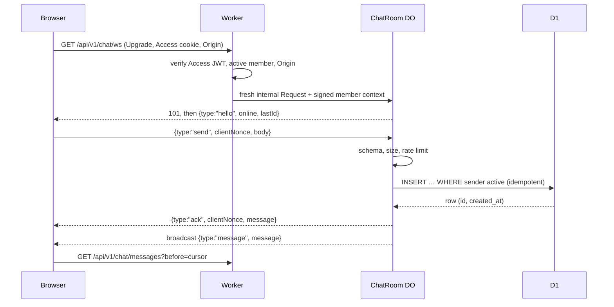

# 09 — Live chat

**Covers:** The chat room, the WebSocket handshake and trusted context, the ChatRoom Durable Object, message persistence, history, presence, suspension, retention, archive and pruning.
**Read when:** touching `/chat`, `src/lib/server/adapters/cloudflare/chat-room.ts`, the `RealtimeHub` port, chat history or the chat archive scripts.
**Owns:** `R-CHAT-*`, `AC-CHAT-*`.
**Index:** `docs/spec/SPEC.md` (product boundary §1, locked decisions D1–D10, routing). Section numbers are global: `§9.n` is in this file.

---

## 9.1 Room and messages

- **R-CHAT-01** One room per deployment (`room_id = "main"`). Messages are text: Unicode and emoji, 1–1,000
  characters after trimming, no attachments, no Markdown (links are auto-linked on display, `https:` only).
- **R-CHAT-02** The server generates the message id (UUIDv7) and `created_at`; the client sends a `clientNonce`
  (UUID) per message, reused on retry. `(sender_id, client_nonce)` is unique, so a retried send returns the original
  message instead of a duplicate.
- **R-CHAT-03** Senders may delete their own message and admins any message; a deleted message is a tombstone
  (`deleted_at`, body cleared) shown as *message deleted* where continuity needs it.

## 9.2 Connecting

- **R-CHAT-04** **Handshake.** `/api/v1/chat/ws` verifies identity (R-AUTH-03), active membership and `Origin`
  (R-AUTH-17) **before** contacting the Durable Object. It then sends the DO a new Request built from scratch (no
  client header is forwarded) carrying `X-ClassHub-Context`: `{ memberId, role, displayName, authUntil, exp }` (`authUntil` is the verified Access JWT's `exp`) signed with
  HMAC-SHA-256 under the Worker secret `INTERNAL_CONTEXT_KEY`, expiring in 30 s. Its URL carries only the site's
  origin (`?origin=`), which the DO keeps on the socket when it is an `https://` origin, as the VAPID `sub` of the
  pushes that socket's messages trigger (R-NTF-01). The DO rejects any request without a valid, unexpired context; it
  has no public route.
- **R-CHAT-05** **Sending.** The DO validates the frame with Zod (≤ 4 KB), applies a per-member token bucket (1 per
  second, burst 5; `429`-style `{type:"error", code:"rate_limited"}`), and inserts with
  `INSERT … SELECT … WHERE EXISTS (SELECT 1 FROM users WHERE id = ? AND status = 'active')` and `ON CONFLICT
  (sender_id, client_nonce) DO NOTHING` followed by a read of the row.
- **R-CHAT-06** **Persist before ack** (INV-8): the ack and the broadcast go out only after D1 returned the committed
  row. A D1 error returns `{type:"error", code:"not_saved", clientNonce}` and the client keeps the message as
  *not sent — retry*.
- **R-CHAT-07** **Hibernation.** The DO uses the WebSocket Hibernation API (`acceptWebSocket`, `webSocketMessage`,
  `webSocketClose`, `serializeAttachment` for `{ memberId, role, displayName, connectedAt, authUntil }`). It keeps no timers or
  polling loops; presence is derived from `getWebSockets()` and broadcast as an `online` count on connect and
  disconnect.
- **R-CHAT-08** **No authoritative state in the DO** (INV-2): no message history in DO storage; the SQLite-backed DO
  class exists because Workers Free requires it. Rate-limit buckets and presence are memory-only and may reset.
- **R-CHAT-09** **Suspension.** Suspending or deleting a member calls `RealtimeHub.disconnectMember(memberId)`,
  which closes that member's sockets with code 4003; the conditional insert (R-CHAT-05) also refuses sends from a
  member whose status changed in the meantime. This call is best effort; R-CHAT-16 is what guarantees delivery stops.
- **R-CHAT-16** **Sockets never outlive authorization.** Every broadcast is authorized in the same D1 batch as the
  insert (R-CHAT-05): `SELECT id FROM users WHERE status = 'active' AND id IN (<connected member ids>)` (at most 50
  values, under D1's 100-variable limit: the sender first, then other connected members; a member beyond the 50 is
  neither closed nor sent that message), plus `site_settings.setup_state` and the chat feature flag (R-NAV-02). The DO
  broadcasts only to sockets whose member id was returned and closes the others with 4003 (a socket that opens
  while the batch runs is not in the returned set; it is broadcast to on its own signed context, at most 30 s old, and
  counts as reached for R-NTF-07); if `setup_state` is not
  `unlocked` (R-OPS-11) or chat is off, it closes every socket with 4003 and broadcasts nothing (the message is still
  saved when the sender was authorized). If the authorization read fails, the message is saved and acked but not
  broadcast (the batch is atomic, so this is a batch that committed but returned unusable authorization rows; a
  batch that failed is R-CHAT-06's `not_saved`); clients catch up with `after=` (R-CHAT-11). Each socket's `authUntil`
  is checked on every inbound message and before any frame is sent to it (`message`, `deleted`, `online`; `hello`
  follows the context check at accept): a socket past it gets nothing and is closed with 4001 (the client then reloads
  through Access); no timers are used (R-CHAT-07). So suspension, lock, chat-off and an expired Access session each
  stop delivery without relying on `disconnectMember`.
- **R-CHAT-17** **No gap at startup.** `hello` carries `lastId`, the newest persisted message id. The client compares it
  with the newest id from its HTTP history load (R-CHAT-10) and fetches `after=<id>` when they differ, so messages
  sent between the history load and the socket opening are not lost.
- **Frames** (one Zod module, `src/lib/contracts/chat.ts`, shared by both hub adapters and the client). Client → room:
  `{type:"send", clientNonce, body}` and nothing else (identity is the socket's attachment, never the frame). Room →
  client: `{type:"hello", online, lastId}` (`lastId` null in an empty room), `{type:"online", online}` on every connect
  and disconnect, `{type:"ack", clientNonce, message}`, `{type:"message", message}`, `{type:"deleted", id}` after a
  tombstone (R-CHAT-03), and `{type:"error", code, clientNonce?}` with `code` one of `validation`,
  `payload_too_large`, `rate_limited`, `not_saved`. A `message` is `{id, createdAt, sender, deleted, body}`, where
  `sender` is `{id, displayName, avatarMediaId?}` as the projection shows it to every member (R-PROF-04) and a
  tombstone has `deleted: true` and no `body`. The body limit counts Unicode code points, so an emoji is one
  character. History (`GET /api/v1/chat/messages`) returns `{items, nextCursor}` oldest first; `nextCursor` is the id
  to pass as the same `before=`/`after=` for the next page, or null. Close codes: 4003 not authorized, 4001 session
  expired.

## 9.3 Client behaviour

- **R-CHAT-10** On open, `/chat` loads the newest 50 messages over HTTP (`GET /api/v1/chat/messages`), connects the
  socket, and scrolls to the newest. Older messages load 50 at a time with `before=<id>` (keyset on
  `(created_at, id)`).
- **R-CHAT-11** **Reconnect** with exponential backoff (1 s doubling to 30 s, with jitter), showing *reconnecting*;
  after reconnecting it fetches messages after the last one it has (`after=<id>`) so the timeline is gap-free and in
  order. No polling while connected; the socket closes when the tab is hidden for over 5 minutes and reopens on
  return.
- **R-CHAT-12** The last-read message id is kept in `localStorage` (`classhub.chat.lastRead`) to show an unread
  marker; nothing about reading is sent to the server.

## 9.4 Retention, archive and pruning

- **R-CHAT-13** **Policy:** keep messages newer than `chat.retainDays` (default 365) **and** at most
  `chat.maxMessages` (default 30,000); older ones are candidates for pruning. Discussions have no automatic retention
  (R-BRD-09).
- **R-CHAT-14** **Archive before prune, fail closed** (INV-7): `npm run export-chat` (CLI, off-provider) writes
  one NDJSON file per candidate range, named by its first and last message id and time range
  (`chat/<fromId>_<toId>.ndjson.age`), never overwritten (a name collision aborts); later candidates from an
  already partly pruned month go in a new file. Each file has a SHA-256, then the export re-reads the written files, checks
  record counts and hashes against D1, and only then records a `chat_archives` row with `verified_at`.
  `npm run prune-chat` deletes only rows inside a range with a verified, un-purged archive and sets `purged_at`. With no
  verified archive, nothing is deleted and `/admin` shows *chat over retention: run export-chat*. An R2 copy never
  counts as the independent archive. `export-chat` and `prune-chat` take the same **backup lock** as `backup` (R-BAK-03), so
  they never run concurrently with it or with each other. **Archives are encrypted with `age`, like backups (R-BAK-05), and encryption is
  mandatory:** `export-chat` refuses to write unencrypted output when no recipient key is configured. The SHA-256 and
  record counts are checked on the decrypted content.
- **R-CHAT-18** **Prune in chunks.** `prune-chat` deletes verified ranges in chunks (for example 1,000 rows per
  statement batch, paced) so one run stays within the D1 daily write allowance once index writes count (§14); an
  interrupted run resumes from the remaining rows and `purged_at` is set only when the range is empty. It holds the backup lock of R-BAK-03 for the whole run.
- **R-CHAT-15** Archives are not shown in the UI; an admin restores one with `npm run restore -- --chat <file>`. **`restore --chat` is insert-only**
  (`INSERT … ON CONFLICT DO NOTHING`, never update or delete, so it cannot contradict R-BAK-08), skips messages of
  completed deletion requests (R-PROF-11), and refuses to run unless a verified backup of the current database
  exists first (R-BAK-03).
  Members can't bulk-export the chat; admins export it through the CLI only. Pruning and archives honour completed
  deletion requests (R-PROF-11): a member's deleted messages are omitted from later archives.

## Acceptance criteria

| ID | Criterion | Rules | Proved by |
|---|---|---|---|
| AC-CHAT-01 | Two browsers chat live, see each other's messages in order with the online count | R-CHAT-05, 07 | e2e (`dev:offline`, local hub) + manual 4b in production |
| AC-CHAT-02 | A resent `clientNonce` yields one row and the original id | R-CHAT-02 | integration (DO pool) |
| AC-CHAT-03 | With D1 failing, the sender gets `not_saved` and nobody receives a broadcast | R-CHAT-06 | integration with failing adapter |
| AC-CHAT-04 | A direct request to the DO without a valid signed context, or with an expired one, is refused | R-CHAT-04 | `test:security` |
| AC-CHAT-05 | A suspended member's socket closes with 4003 and a send racing the suspension is refused; with `disconnectMember` throwing, no further broadcast reaches the member | R-CHAT-09, 16, 05 | integration |
| AC-CHAT-06 | The sixth message inside one second is rate-limited | R-CHAT-05 | integration |
| AC-CHAT-07 | After a dropped connection, the client reconnects and shows missed messages in order with no duplicates | R-CHAT-11 | e2e |
| AC-CHAT-08 | The WebSocket works through hostname-based Access in production | R-CHAT-04, D6 | manual 4b |
| AC-CHAT-09 | `prune-chat` deletes nothing without a verified archive, and exactly the archived range with one | R-CHAT-14 | integration |
| AC-CHAT-10 | `export-chat` detects a truncated NDJSON file and refuses to record `verified_at` | R-CHAT-14 | unit |
| AC-CHAT-11 | The DO class writes nothing to DO storage | R-CHAT-08 | unit (storage spy) + review |
| AC-CHAT-12 | After `setup_state` leaves `unlocked`, the next message closes every socket with 4003 and no broadcast is delivered | R-CHAT-16 | integration |
| AC-CHAT-13 | With chat turned off, the next message closes every socket with 4003 and nothing is broadcast; messages stay stored | R-CHAT-16, R-NAV-02 | integration |
| AC-CHAT-14 | A socket whose `authUntil` has passed is closed with 4001 on its next message, and receives no broadcast, deletion or presence frame (it is closed with 4001 instead); with the authorization read failing, the message is saved and not broadcast | R-CHAT-16 | integration (fake clock, failing adapter) |
| AC-CHAT-15 | A message sent between the HTTP history load and the socket open is fetched via `hello.lastId` and `after=` exactly once | R-CHAT-17 | e2e |
| AC-CHAT-16 | `export-chat` never overwrites an existing archive, refuses to write without an `age` recipient, and `restore --chat` adds only missing rows, skips deleted members' messages and refuses without a verified backup | R-CHAT-14, 15 | unit + integration |
| AC-CHAT-17 | `prune-chat` deletes in bounded chunks and resumes after an interruption without losing or double-purging rows | R-CHAT-18 | integration |
