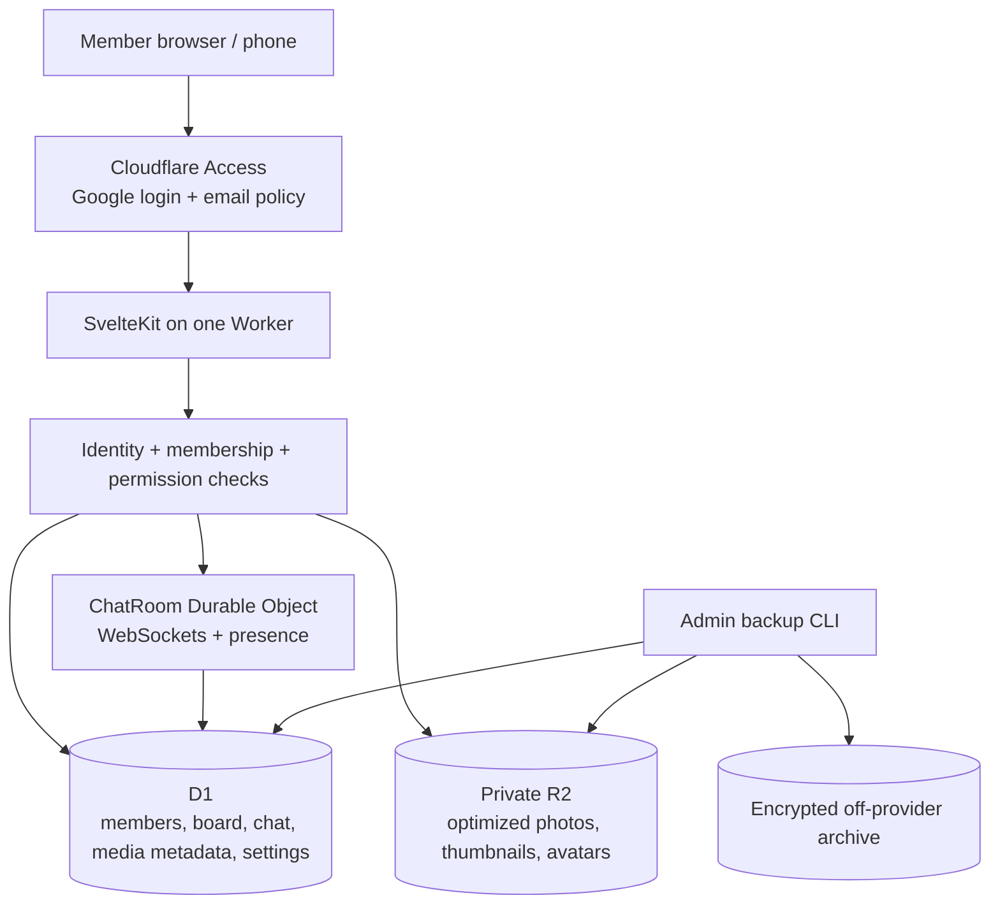

# 02 — Platform and repo

**Covers:** Stack, runtime flow, ports and adapters, repo layout, local development, CI, the Cloudflare account guard.
**Read when:** scaffolding, adding a dependency, a port, an adapter, a script, a CI step or anything that runs `wrangler`.
**Owns:** `R-PLAT-*`, `AC-PLAT-*`.
**Index:** `docs/spec/SPEC.md` (product boundary §1, locked decisions D1–D10, routing). Section numbers are global: `§2.n` is in this file.

---

## 2.1 Runtime flow



- **R-PLAT-01** **Request handling.** Pages are rendered by SvelteKit; `hooks.server.ts` resolves identity and
  membership once per request (§6) and puts a typed `locals.member` (or nothing) on the request. Private page data is
  only ever loaded server-side after that check; no private content is in the build output, and no private route is
  prerendered. API endpoints live under `/api/v1/*` (§11) and use the same authorization service. Media is streamed by
  `/api/v1/media/:id/:variant` (§7.5); chat upgrades on `/api/v1/chat/ws` (§9.2).
- **R-PLAT-02** **One Worker, one entry.** The Worker entry (`src/worker.ts`) wraps SvelteKit's `adapter-cloudflare`
  output and exports the `ChatRoom` Durable Object class from
  `src/lib/server/adapters/cloudflare/chat-room.ts` (INV-4 keeps Cloudflare types inside the adapter directory);
  there is no second Worker, no Pages project and no separate API service. `wrangler.jsonc` sets
  `workers_dev: true` and `preview_urls: false` (preview hostnames would sit outside the Access application,
  R-AUTH-02).

## 2.2 Stack

- **R-PLAT-04** Node.js 24 LTS or newer (`.nvmrc`), npm with a committed `package-lock.json`. SvelteKit 2 + Svelte 5
  (runes) + TypeScript in `strict` mode; `@sveltejs/adapter-cloudflare` for the Worker build and
  `@sveltejs/adapter-node` for the Node target (§13.5), picked by `CLASSHUB_TARGET`. Drizzle ORM with
  `drizzle-orm/sqlite-core` for schema and typed queries, migrations as committed plain SQL (§5.5). Zod for every input
  and API DTO. Vitest for unit and integration tests, `@cloudflare/vitest-pool-workers` for tests against D1, R2 and the
  Durable Object, Playwright for end-to-end. ESLint + Prettier + `svelte-check`.
- **R-PLAT-05** **Few dependencies.** No UI component library (D9), no CSS framework, no analytics, no hosted fonts or
  search. Each runtime dependency is justified in the slice that adds it; versions are pinned through the lock file.
  The Markdown renderer and HTML sanitizer must run in the Worker runtime (no DOM) (R-BRD-03).

## 2.3 Ports and adapters

| Port (`src/lib/server/ports/`) | Cloudflare adapter | Local adapter |
|---|---|---|
| `Database` (Drizzle SQLite handle + `batch`) | D1 | `better-sqlite3` file |
| `ObjectStorage` (§11.3) | native R2 binding | filesystem directory |
| `IdentityProvider` (§11.3) | Access JWT verifier | dev identity, localhost only |
| `RealtimeHub` (§11.3) | Durable Object bridge | in-process `ws` hub |
| `JobRunner` | Cron Trigger (only where §14 allows) or CLI | CLI |
| `SiteConfigRepository` | D1 `site_settings` over `site.config.ts` defaults | same, SQLite |

- **R-PLAT-03** Application services (`src/lib/server/services/`) and repositories (`.../repositories/`) depend only on
  ports. Only `src/lib/server/adapters/cloudflare/*` and `src/worker.ts` import Cloudflare types (INV-4). Adapters are
  chosen once, in `src/lib/server/context.ts`, from the platform object SvelteKit passes in (Cloudflare) or from
  environment (Node/local).
- **R-PLAT-06** **One contract suite per port.** Each port has a shared test suite (`tests/contract/<port>.ts`) run
  against both its Cloudflare and its local adapter; an adapter is done when both pass the same suite (§16 criterion
  "local adapters pass the same tests").
- **R-PLAT-07** Repositories expose domain operations (`listPosts(cursor)`, `reserveUpload(...)`), never raw SQL to
  routes or components. Every query is parameterized and bounded by `LIMIT` (R-DB-07).

## 2.4 Repo layout

```text
classhub/
├── README.md  LICENSE  CONTRIBUTING.md  CODE_OF_CONDUCT.md  SECURITY.md  CHANGELOG.md
├── site.config.ts                 # public defaults, no secrets (§10.2)
├── package.json  package-lock.json  svelte.config.js  vite.config.ts  tsconfig.json  .nvmrc
├── wrangler.jsonc.example         # template; the real wrangler.jsonc is generated and gitignored
├── .env.cloudflare.example        # account id + API token names; the real file is gitignored (§2.6)
├── .dev.vars.example
├── .github/workflows/ci.yml  .github/workflows/deploy.yml  .github/ISSUE_TEMPLATE/
├── src/
│   ├── worker.ts                  # Worker entry: SvelteKit + ChatRoom export (R-PLAT-02)
│   ├── hooks.server.ts            # identity, membership, headers, request id
│   ├── routes/                    # pages and /api/v1 endpoints (§3, §11)
│   └── lib/
│       ├── components/  themes/  i18n/  contracts/  config/
│       └── server/ services/ repositories/ ports/ auth/ db/ adapters/{cloudflare,local}/
│           └── cloudflare/chat-room.ts  # Durable Object class (R-PLAT-02)
├── migrations/                    # numbered portable SQL (§5.5)
├── scripts/                       # cf.mjs guard, setup, invite, backup, restore, verify-backup, export-chat, preflight, unlock
├── tests/ unit/ contract/ integration/ e2e/ security/ fixtures/
└── docs/ spec/ plan/ DEPLOY_CLOUDFLARE.md GOOGLE_ACCESS.md THEMES.md BACKUP_RESTORE.md SELF_HOST_NODE.md MIGRATION.md PRIVACY.md
```

- **R-PLAT-08** One repo, one app: no monorepo, no separate API service, no Docker requirement for the default
  Cloudflare install.
- **R-PLAT-09** `.gitignore` covers `wrangler.jsonc`, `.env*` except `*.example`, `.dev.vars`, `.wrangler/`,
  `.svelte-kit/`, `build/`, `data/` (local SQLite and media), `backups/`, `node_modules/`. Fixtures and
  screenshots use synthetic people only (INV-6).

## 2.5 Local development and CI

- **R-PLAT-10** `npm run dev` runs Vite with Cloudflare dev bindings (`getPlatformProxy`: local D1, R2 and the Durable
  Object). `npm run dev:offline` runs on the local adapters: SQLite in `data/dev.sqlite`, media in `data/objects/`,
  the in-process WebSocket hub and the dev identity. The dev identity accepts a chosen fixture member only when the
  request host is `localhost`/`127.0.0.1` and the build is a dev build; production builds do not contain it
  (R-AUTH-13). `npm run db:seed:demo` creates synthetic classmates, posts, albums and generated placeholder images.
- **R-PLAT-11** **`npm run verify`** runs, in order: `lint` (ESLint + Prettier check), `check` (`svelte-check` +
  `tsc`), `test` (Vitest: unit, contract on local adapters, integration on the Workers pool), `test:migrations`
  (migrations apply from empty and from each released schema, §5.5), `test:security` (§6.7), `build` (Cloudflare
  target) and `build:node`. CI runs the same script on every pull request, then `test:e2e` (Playwright against
  `dev:offline`). CI never uploads `.dev.vars`, `.env.cloudflare`, contact data or backups as artifacts.

## 2.6 The Cloudflare account guard

The reference deployment lives in a **second Cloudflare account**, separate from the account the maintainer's other
projects use, and any cloner may have several accounts. A global `wrangler login` points at one account for every
project on the machine, so the app never relies on it.

- **R-PLAT-12** **Every Cloudflare command goes through `scripts/cf.mjs`.** It loads the gitignored `.env.cloudflare`
  (`CLOUDFLARE_ACCOUNT_ID`, `CLOUDFLARE_API_TOKEN`, later `ACCESS_TEAM_DOMAIN` and `ACCESS_AUD`), refuses to run when
  the account id is missing, checks with `wrangler whoami` that the token can see that account, and runs `wrangler`
  with both values in its environment. Every npm script that touches Cloudflare (`deploy`, `db:migrate:remote`,
  `setup`, `preflight`, `unlock`, `backup`, `restore`, `invite`) calls it; nothing in the repo calls `npx wrangler`
  against a remote resource directly (INV-9).
- **R-PLAT-13** The generated `wrangler.jsonc` carries `account_id` from `.env.cloudflare`, so a stray direct
  `wrangler deploy` also lands in the configured account. `.env.cloudflare.example` names an **account-scoped API
  token** with Workers Scripts Edit, D1 Edit, Workers R2 Storage Edit, Account Settings Read and, for the optional
  invite sync (R-AUTH-18), Access: Apps and Policies Edit; it never holds values.
- **R-PLAT-14** `deploy.yml` (optional, §12.7) reads the same two values from a protected GitHub environment's secrets.

## Acceptance criteria

| ID | Criterion | Rules | Proved by |
|---|---|---|---|
| AC-PLAT-01 | A clean clone with `npm ci` runs `npm run verify` green and `npm run dev:offline` serves the shell | R-PLAT-04, 10, 11 | CI + manual 0a |
| AC-PLAT-02 | No file outside `adapters/cloudflare/` and `src/worker.ts` imports a Cloudflare type or binding | R-PLAT-03 | `test:security` lint rule |
| AC-PLAT-03 | Every port's contract suite passes on both adapters | R-PLAT-06 | `test` (contract) |
| AC-PLAT-04 | The Worker build exports `ChatRoom`, has no preview URLs and serves `/health` | R-PLAT-02 | integration test + `wrangler deploy --dry-run` 0a |
| AC-PLAT-05 | No private route is prerendered and the client bundle contains no fixture or seeded member data | R-PLAT-01, 09 | `test:security` bundle scan |
| AC-PLAT-06 | `scripts/cf.mjs` refuses to run with no account id, and with a token that can't see that account | R-PLAT-12 | unit test with a fake `wrangler` |
| AC-PLAT-07 | `grep -rn 'npx wrangler\|wrangler ' package.json scripts/` finds remote calls only inside `cf.mjs` | R-PLAT-12 | `test:security` |
| AC-PLAT-08 | The generated `wrangler.jsonc` has the configured `account_id`, and is gitignored | R-PLAT-13, 09 | setup test 1d |
| AC-PLAT-09 | The dev identity is absent from the production bundle | R-PLAT-10 | `test:security` bundle scan |
